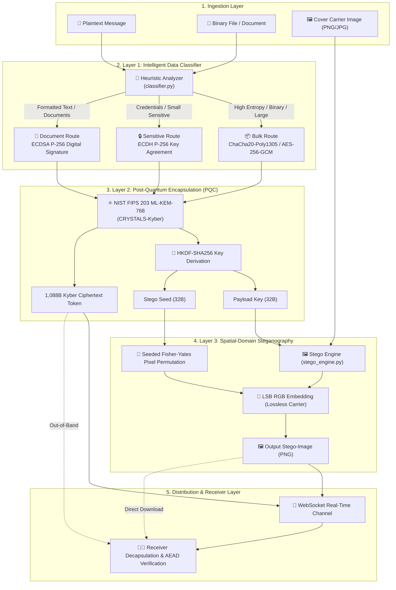
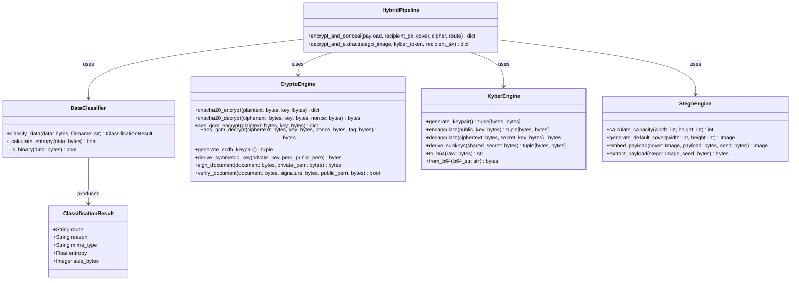

# 🛡️ Hybrid Multi-Level Post-Quantum Security System (FGP)

<p align="center">
  
  
  
  
  
  
  
  
</p>

> **Graduation Capstone Project — Mustansiriyah University, College of Engineering**  
> An advanced multi-level defense system integrating data-type-aware cryptographic routing, post-quantum lattice-based key encapsulation (**NIST FIPS 203 ML-KEM-768 / CRYSTALS-Kyber**), constant-time AEAD symmetric ciphers, and seeded spatial-domain steganography.

---

## 📑 Table of Contents
1. [Core Features](#-core-features)
2. [System Architecture Diagrams](#-system-architecture-diagrams)
   - [System Context & Multi-Layer Pipeline](#level-1-system-architecture-flowchart)
   - [End-to-End Encryption & Concealment Sequence](#level-2-encryption--concealment-flow)
   - [Decryption & Extraction Sequence](#level-3-decryption--extraction-flow)
   - [Core System Class Diagram](#level-4-class-diagram)
3. [Cryptographic Decisions & Theoretical Justifications](#-cryptographic-decisions--theoretical-justifications)
4. [Quick Start & Installation](#-quick-start)
5. [Running the Test Suite](#-running-the-test-suite)
6. [API Endpoints Reference](#-api-endpoints-reference)
7. [Academic Project Team](#-academic-project-team)
8. [License](#-license)

---

## 🌟 Core Features

- 🧠 **Intelligent Heuristic Classifier:** Dynamically inspects payload entropy, MIME type, and size to route data through specialized cryptographic channels (Bulk, Sensitive, or Non-Repudiated Document).
- ⚛️ **Post-Quantum Cryptography (NIST FIPS 203):** Integrates **ML-KEM-768** (CRYSTALS-Kyber) lattice key encapsulation over polynomial rings $R_q = \mathbb{Z}_q[X]/(X^{256} + 1)$, ensuring resistance against quantum cryptanalysis (Shor's algorithm).
- 🔐 **Dual AEAD Symmetric Ciphers:** Provides constant-time **ChaCha20-Poly1305** (resistant to cache-timing side channels) alongside standard **AES-256-GCM**.
- ✍️ **Asymmetric Cryptography:** Classical **ECDH P-256** key agreement and **ECDSA P-256** digital signatures for non-repudiation of sensitive documents.
- 🖼️ **Kyber-Seeded Spatial LSB Steganography:** Uses the 32-byte post-quantum shared secret to seed a pseudo-random Fisher-Yates pixel permutation. Hidden data is imperceptible ($\Delta E < 0.05, \text{PSNR} > 48\text{ dB}$) and impossible to locate without decapsulating the Kyber token.
- 📡 **Real-Time Peer Channel:** Embedded WebSocket communication for zero-setup peer exchange and instant stego-carrier transfer.
- 🔑 **In-Browser Local Key Vault:** Generates, previews, and exports NIST FIPS 203 public/secret keypairs entirely in memory.

---

## 🏗️ System Architecture Diagrams

### Level 1: System Architecture Flowchart

Visual representation of data routing, cryptographic transformations, and steganographic concealment across the multi-level pipeline.



---

### Level 2: Encryption & Concealment Flow

Step-by-step sequence diagram showing data classification, post-quantum key encapsulation, symmetric encryption, and steganographic embedding.

```mermaid
sequenceDiagram
    autonumber
    actor Sender as 🧑‍💻 Sender
    participant UI as 🌐 Workstation UI
    participant Classifier as 🧠 Heuristic Classifier
    participant Kyber as ⚛️ NIST ML-KEM-768
    participant Crypto as 🔐 Crypto Engine
    participant Stego as 🖼️ Stego Engine
    participant PeerChannel as 📡 WebSocket Channel
    actor Receiver as 🧑‍💼 Receiver

    Sender->>UI: Input Payload (Text / File) & Recipient Kyber Public Key
    UI->>Classifier: classify_data(data, filename)
    Classifier-->>UI: Classification Result (Bulk / Sensitive / Document)

    rect rgb(23, 28, 48)
        Note over UI,Kyber: Post-Quantum Key Encapsulation (Layer 2)
        UI->>Kyber: encapsulate(recipient_pk)
        Kyber-->>UI: 1,088B Ciphertext Token + 32B Shared Secret
        UI->>Kyber: HKDF-SHA256(Shared Secret)
        Kyber-->>UI: Payload Key (32B) + Stego Seed (32B)
    end

    rect rgb(28, 23, 48)
        Note over UI,Crypto: Dynamic Cryptographic Routing (Layer 1)
        alt Bulk Data Route
            UI->>Crypto: chacha20_encrypt(payload, payload_key) [or AES-256-GCM]
            Crypto-->>UI: Ciphertext + 16B Poly1305 Tag
        else Sensitive Data Route
            UI->>Crypto: ecdh_derive() + ChaCha20 AEAD
            Crypto-->>UI: Dual-Encrypted Ciphertext
        else Document Route
            UI->>Crypto: ecdsa_sign(payload) + ChaCha20 AEAD
            Crypto-->>UI: Ciphertext + 64B ECDSA Signature
        end
    end

    rect rgb(23, 40, 35)
        Note over UI,Stego: Spatial-Domain Steganography (Layer 3)
        UI->>Stego: embed_payload(carrier_image, encrypted_package, stego_seed)
        Stego->>Stego: Seeded Fisher-Yates Pixel Permutation
        Stego->>Stego: Least Significant Bit (LSB) RGB Modification
        Stego-->>UI: Lossless Stego-Image (PNG)
    end

    alt Direct Download Mode
        UI-->>Sender: Download Stego-Image PNG + 1,088B Token
    else Live Peer Channel Mode
        UI->>PeerChannel: broadcast_stego_package(stego_png, token)
        PeerChannel-->>Receiver: Push Real-Time Notification & Carrier Package
    end
```



---

### Level 3: Decryption & Extraction Flow

Step-by-step sequence diagram illustrating carrier unpacking, seed reconstruction via ML-KEM decapsulation, bit extraction, and authenticated AEAD decryption.

```mermaid
sequenceDiagram
    autonumber
    actor Receiver as 🧑‍💼 Receiver
    participant UI as 🌐 Workstation UI
    participant Kyber as ⚛️ NIST ML-KEM-768
    participant Stego as 🖼️ Stego Engine
    participant Crypto as 🔐 Crypto Engine

    Receiver->>UI: Upload Stego PNG + 1,088B Token + Kyber Secret Key (2,400B)
    
    rect rgb(23, 28, 48)
        Note over UI,Kyber: Post-Quantum Decapsulation
        UI->>Kyber: decapsulate(token, recipient_sk)
        Kyber-->>UI: 32B Shared Secret
        UI->>Kyber: HKDF-SHA256(Shared Secret)
        Kyber-->>UI: Payload Key (32B) + Stego Seed (32B)
    end

    rect rgb(23, 40, 35)
        Note over UI,Stego: Seeded Spatial Bit Extraction
        UI->>Stego: extract_payload(stego_png, stego_seed)
        Stego->>Stego: Reconstruct Pixel Permutation from Stego Seed
        Stego->>Stego: Extract LSB RGB Sequence & Unpack Header
        Stego-->>UI: Encrypted Package (IV + Tag + Ciphertext)
    end

    rect rgb(28, 23, 48)
        Note over UI,Crypto: AEAD Decryption & Integrity Verification
        UI->>Crypto: chacha20_decrypt(ciphertext, payload_key, nonce, tag)
        Crypto->>Crypto: Constant-Time Poly1305 MAC Verification
        
        opt Document Route
            Crypto->>Crypto: Verify ECDSA P-256 Digital Signature
        end
        
        Crypto-->>UI: Verified Plaintext / Original Binary File
    end

    UI-->>Receiver: Display Verified Plaintext Preview & File Download
```



---

### Level 4: Class Diagram

Object-oriented architecture of the Python core backend modules and engine controllers.



---

## 🔬 Cryptographic Decisions & Theoretical Justifications

| Cryptographic Primitive | Selected Algorithm | Alternative Rejected | Justification & Architectural Trade-off |
| :--- | :--- | :--- | :--- |
| **Symmetric AEAD** | **ChaCha20-Poly1305** | AES-256-GCM | Constant-time execution using ARX (Add-Rotate-Xor) instructions prevents cache-timing side-channel attacks on CPUs without dedicated AES-NI hardware. |
| **Key Agreement** | **ECDH P-256** | RSA-3072 | Achieves 128-bit quantum-equivalent classical security with a compact 64-byte key (vs. 384 bytes for RSA), executing 15× faster with minimal memory footprint. |
| **Digital Signatures** | **ECDSA P-256** | Raw ElGamal | Compact 64-byte deterministic signatures with native elliptic curve subgroup verification, avoiding massive modular arithmetic overhead. |
| **Post-Quantum Key Exchange**| **ML-KEM-768 (Kyber)** | Classic McEliece / NTRU | Standardized under **NIST FIPS 203**. Offers optimal balance: 1,184B public key, 1,088B ciphertext, and quantum resistance against Shor's algorithm. |
| **Carrier Concealment** | **Seeded Spatial LSB** | Frequency DCT / Wavelet | Stego seed derived from Kyber shared secret determines pseudo-random pixel permutation, eliminating statistical cluster artifacts while maintaining $\Delta E < 0.05$. |

---

## 🚀 Quick Start

### Prerequisites
- Python **3.10** or higher installed on your system.

### 1. Clone & Set Up Environment
```bash
# Clone the repository
git clone https://github.com/yousiff139-lang/FGP.git
cd FGP

# (Optional) Create and activate virtual environment
python -m venv venv
# Windows:
.\venv\Scripts\activate
# Linux/macOS:
source venv/bin/activate

# Install required dependencies
pip install -r requirements.txt
```

### 2. Launch the Application
```bash
python run.py
```
Open your browser and navigate to:
👉 **`http://localhost:8000`**

---

## 🧪 Running the Test Suite

The system includes a dedicated unit and integration test suite in `tests/` validating all cryptographic, steganographic, classification, and API routes.

Execute pytest:
```bash
python -m pytest tests/ -v
```

### Test Suite Summary:
```text
tests/test_api.py::test_api_home_page PASSED                             [  2%]
tests/test_api.py::test_api_keygen PASSED                                [  5%]
tests/test_api.py::test_api_classify_text PASSED                         [  8%]
tests/test_api.py::test_api_classify_file PASSED                         [ 11%]
tests/test_api.py::test_api_encrypt_and_decrypt_roundtrip PASSED         [ 14%]
tests/test_api.py::test_api_encrypt_missing_key PASSED                   [ 17%]
tests/test_classifier.py::test_classifier_manual_overrides PASSED        [ 20%]
tests/test_classifier.py::test_classifier_binary_extension PASSED        [ 23%]
tests/test_classifier.py::test_classifier_small_sensitive_data PASSED    [ 26%]
tests/test_classifier.py::test_classifier_large_document PASSED          [ 29%]
tests/test_classifier.py::test_classifier_large_binary_payload PASSED    [ 32%]
tests/test_crypto.py::test_chacha20_poly1305_roundtrip PASSED            [ 35%]
tests/test_crypto.py::test_chacha20_tamper_detection PASSED              [ 38%]
tests/test_crypto.py::test_aes_gcm_roundtrip PASSED                      [ 41%]
tests/test_crypto.py::test_aes_gcm_tamper_detection PASSED               [ 44%]
tests/test_crypto.py::test_ecdh_key_agreement PASSED                     [ 47%]
tests/test_crypto.py::test_ecdsa_signature_verification PASSED           [ 50%]
tests/test_crypto.py::test_ecdsa_tamper_fails PASSED                     [ 52%]
tests/test_kyber.py::test_kyber_keypair_generation PASSED                [ 55%]
tests/test_kyber.py::test_kyber_encapsulation_and_decapsulation PASSED   [ 58%]
tests/test_kyber.py::test_kyber_base64_helpers PASSED                    [ 61%]
tests/test_kyber.py::test_kyber_invalid_key_lengths PASSED               [ 64%]
tests/test_kyber.py::test_derive_subkeys_from_kyber PASSED               [ 67%]
tests/test_pipeline.py::test_pipeline_bulk_chacha20 PASSED               [ 70%]
tests/test_pipeline.py::test_pipeline_bulk_aes_gcm PASSED                [ 73%]
tests/test_pipeline.py::test_pipeline_sensitive_route PASSED             [ 76%]
tests/test_pipeline.py::test_pipeline_document_ecdsa_signature PASSED    [ 79%]
tests/test_pipeline.py::test_pipeline_custom_cover_image PASSED          [ 82%]
tests/test_pipeline.py::test_pipeline_wrong_recipient_sk PASSED          [ 85%]
tests/test_stego.py::test_stego_capacity_calculation PASSED              [ 88%]
tests/test_stego.py::test_stego_create_default_cover PASSED              [ 91%]
tests/test_stego.py::test_stego_embed_and_extract_roundtrip PASSED       [ 94%]
tests/test_stego.py::test_stego_wrong_seed_fails PASSED                  [ 97%]
tests/test_stego.py::test_stego_capacity_overflow PASSED                 [100%]

============================= 34 passed in 2.01s ==============================
```

---

## 📝 API Endpoints Reference

| Method | Endpoint | Description | Request Type | Response |
| :--- | :--- | :--- | :--- | :--- |
| `GET` | `/` | Serves the main workstation web application | — | HTML / Static Assets |
| `GET` | `/api/keygen` | Generates a new NIST FIPS 203 ML-KEM-768 keypair | — | `pk_b64`, `sk_b64` |
| `POST` | `/api/classify` | Heuristically analyzes payload entropy and size | `multipart/form-data` | `route`, `reason`, `entropy` |
| `POST` | `/api/encrypt` | Encrypts payload and embeds it into carrier image | `multipart/form-data` | Stego PNG + 1,088B Token |
| `POST` | `/api/decrypt` | Extracts and decapsulates payload from stego carrier | `multipart/form-data` | Plaintext / Decrypted File |
| `WS` | `/ws/{room_code}` | Real-time WebSocket peer channel for stego dispatch | WebSocket | JSON Broadcast |

---

## 👥 Academic Project Team

### Mustansiriyah University — College of Engineering

- 🎓 **Assist. Prof. Haider Tarish** — Academic Supervisor & Project Advisor
  - *Academic oversight, mathematical rigor, validation of Module-LWE lattice hardness, and thesis defense governance.*
- 🗣️ **Abdulallah Ayad** — Lead Presenter & Post-Quantum Cryptography Researcher
  - *Theoretical framework, literature research on Shor's algorithm, NIST FIPS 203 ML-KEM-768 parameters, and oral defense narration.*
- 💻 **Karrar Haider Ismail** — Systems Architect & Cryptographic Engineer
  - *Classical and quantum-resistant implementations (Kyber, ChaCha20, ECDH, ECDSA), dynamic routing engine, Key Vault, spatial LSB steganography, and full-stack application.*

---

## 📄 License
This project is developed for educational and academic research purposes in fulfillment of the graduation capstone requirements at **Mustansiriyah University, College of Engineering**.
