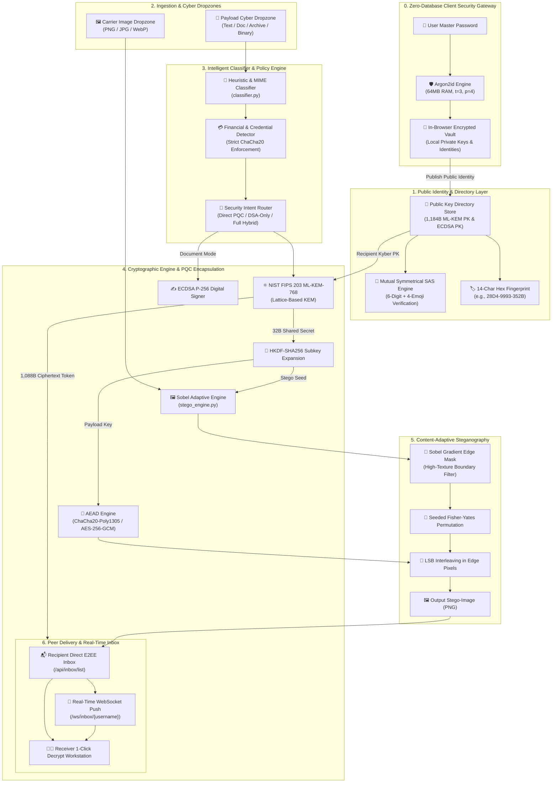

# 🛡️ Hybrid Multi-Level Post-Quantum Security System (FGP)

<p align="center">
  
  
  
  
  
  
  
  
  
</p>

> **Graduation Capstone Project — Mustansiriyah University, College of Engineering**  
> An enterprise-grade, zero-database post-quantum cryptographic workstation integrating:
> - **NIST FIPS 203 ML-KEM-768** (CRYSTALS-Kyber) lattice key encapsulation against quantum adversaries.
> - **Argon2id memory-hard password hashing & KDF derivation** with 100% client-side zero-database key storage.
> - **Public Identity Directory & Direct Peer E2EE Inbox** with 14-character fingerprints and Symmetrical Mutual SAS Safety Numbers.
> - **Constant-time AEAD symmetric ciphers** (ChaCha20-Poly1305 & AES-256-GCM) with automated financial policy enforcement.
> - **Content-adaptive Sobel edge steganography** embedding encrypted payloads exclusively inside high-gradient image textures.
> - **Modular execution pipelines** for Direct PQC, Standalone ECDSA digital signature receipts, or Full Hybrid Stego.

---

## 📑 Table of Contents
1. [Core Features & Upgrades](#-core-features--upgrades)
2. [System Architecture Diagrams (Mermaid)](#-system-architecture-diagrams)
   - [Level 1: System Context & Multi-Layer Pipeline Flowchart](#level-1-system-architecture-flowchart)
   - [Level 2: End-to-End Encryption, Directory Resolution & Inbox Dispatch](#level-2-encryption-directory-resolution--peer-inbox-flow)
   - [Level 3: Peer Decapsulation, Sobel Extraction & Signature Verification](#level-3-peer-decapsulation-sobel-extraction--verification-flow)
   - [Level 4: Comprehensive System Class & Component Architecture](#level-4-class--component-diagram)
3. [Cryptographic Decisions & Theoretical Justifications](#-cryptographic-decisions--theoretical-justifications)
4. [Quick Start & Installation](#-quick-start)
5. [Running the Test Suite](#-running-the-test-suite)
6. [API Endpoints Reference](#-api-endpoints-reference)
7. [Academic Project Team](#-academic-project-team)
8. [License](#-license)

---

## 🌟 Core Features & Upgrades

- 🛡️ **Zero-Database Client Vault & Argon2id Gateway:** 
  Zero credentials or private keys ever touch the server database. Passwords are processed using **Argon2id** (64MB memory cost, 3 iterations, 4 parallelism threads), resisting GPU/ASIC brute-force attacks.
- 👥 **Public Identity Directory & Direct Peer Inbox:** 
  Eliminates fragile room codes. Users publish 1,184-byte Kyber public keys, displaying a 14-character hexadecimal fingerprint (`XXXX-XXXX-XXXX`). Alice sends encrypted messages directly to Bob's inbox with real-time WebSocket push notifications (`/ws/inbox/{username}`).
- 🔢 **Mutual Symmetrical SAS Safety Numbers:** 
  Calculates a deterministic Short Authentication String (6 digits + 4 emojis) derived symmetrically from `BLAKE2b(Sort(PK_Alice || PK_Bob))`. Prevents active Man-in-the-Middle (MITM) attacks by allowing users to verify their connection out-of-band.
- 🖼️ **Content-Adaptive Sobel Edge Steganography:** 
  Unlike standard naive spatial LSB embedding, a **Sobel gradient edge filter** maps high-frequency image textures (sharp edges and contours). Payloads are pseudo-randomly concealed only within edge zones, rendering the carrier visually indistinguishable ($\Delta E < 0.05, \text{PSNR} > 50\text{ dB}$) and impervious to chi-squared statistical steganalysis.
- 🧠 **Payload Intelligence & Financial Policy Enforcement:** 
  Automatically detects credit cards, IBANs, and financial tokens. Automatically enforces constant-time **ChaCha20-Poly1305** to eliminate cache-timing side channels.
- 🎛️ **Modular Cryptographic Pipelines:**
  - **Full Hybrid Stego:** ML-KEM-768 + AEAD + Sobel Edge Steganography.
  - **Modular Direct PQC:** Fast, lightweight quantum-safe communication without steganographic overhead.
  - **Standalone DSA Receipts:** Document authentication via ECDSA P-256 generating verifiable cryptographic receipts (`.sig.json`).
- 📁 **Cyber Drag & Drop Zones:** 
  Futuristic drag-and-drop dropzones for payloads, cover images, and tokens, with visual glow halos, auto-type badge detection (DOC, PDF, ARCHIVE, BIN), and live thumbnail previews.

---

## 🏗️ System Architecture Diagrams

### Level 1: System Architecture Flowchart

Visual representation of data routing, zero-database authentication, cryptographic transformations, and steganographic concealment.



---

### Level 2: Encryption, Directory Resolution & Peer Inbox Flow

End-to-end sequence illustrating how Alice signs in, queries Bob's public key card from the directory, encrypts the payload, and sends it directly to Bob's inbox.

```mermaid
sequenceDiagram
    autonumber
    actor Alice as 🧑‍💻 Alice (Sender)
    participant Gateway as 🛡️ Zero-DB Gateway (Argon2id)
    participant UI as 🌐 Workstation UI
    participant Directory as 📖 Public Directory
    participant Classifier as 🧠 Heuristic & Intent Router
    participant Kyber as ⚛️ NIST ML-KEM-768
    participant Crypto as 🔐 AEAD & ECDSA Engine
    participant Stego as 🖼️ Sobel Stego Engine
    participant Inbox as 📬 Direct Peer Inbox
    actor Bob as 🧑‍💼 Bob (Receiver)

    Alice->>Gateway: Master Password
    Gateway->>Gateway: Argon2id Derivation (64MB RAM, t=3)
    Gateway-->>UI: Unlock Local Vault (Private Keys in RAM only)

    Alice->>UI: Select Recipient @Bob & Drop Payload File
    UI->>Directory: GET /api/directory/peer/Bob
    Directory-->>UI: Bob's Kyber Public Key (1,184B) + 14-Char Fingerprint

    opt Safety Verification
        UI->>Directory: GET /api/directory/safety_number?user_a=Alice&user_b=Bob
        Directory-->>UI: Mutual SAS (e.g. 561-085 🛡️ ⚡ 🔒 🗝️)
        Alice->>Bob: Out-of-band Confirmation of SAS
    end

    UI->>Classifier: evaluate_security_intent(data, filename)
    Classifier-->>UI: Route Decision (Enforce ChaCha20 if Financial)

    rect rgb(23, 28, 48)
        Note over UI,Kyber: Post-Quantum Encapsulation
        UI->>Kyber: encapsulate(bob_kyber_pk)
        Kyber-->>UI: 1,088B Ciphertext Token + 32B Shared Secret
        UI->>Kyber: HKDF-SHA256(Shared Secret)
        Kyber-->>UI: Payload Key (32B) + Stego Seed (32B)
    end

    rect rgb(28, 23, 48)
        Note over UI,Crypto: Authenticated Payload Encryption
        UI->>Crypto: encrypt_chacha20(payload, payload_key)
        Crypto-->>UI: Ciphertext + 16B Poly1305 MAC Tag
    end

    alt Modular Route: Direct PQC Mode
        UI->>Inbox: POST /api/encrypt (direct_pqc package)
    else Modular Route: Full Hybrid Stego
        rect rgb(23, 40, 35)
            Note over UI,Stego: Sobel Edge-Adaptive Concealment
            UI->>Stego: embed(carrier_image, encrypted_package, stego_seed)
            Stego->>Stego: Compute Sobel Horizontal & Vertical Gradients
            Stego->>Stego: Filter High-Texture Edge Coordinates
            Stego->>Stego: Permute Coordinates with Stego Seed
            Stego->>Stego: Embed LSB Bits Exclusively in Edges
            Stego-->>UI: Imperceptible Stego PNG (Delta E < 0.05)
        end
        UI->>Inbox: POST /api/encrypt (Dispatches to Bob's Inbox)
    end

    Inbox->>Bob: WebSocket Real-Time Push Notification (/ws/inbox/Bob)
    Bob-->>UI: Inbox Alert: "New Transmission from @Alice"
```



---

### Level 3: Peer Decapsulation, Sobel Extraction & Verification Flow

Step-by-step sequence diagram illustrating carrier unpacking, seed reconstruction via ML-KEM decapsulation, Sobel edge bit extraction, and authenticated AEAD decryption.

```mermaid
sequenceDiagram
    autonumber
    actor Bob as 🧑‍💼 Bob (Receiver)
    participant UI as 🌐 Workstation UI
    participant Inbox as 📬 Peer Inbox
    participant Kyber as ⚛️ NIST ML-KEM-768
    participant Stego as 🖼️ Sobel Stego Engine
    participant Crypto as 🔐 AEAD & ECDSA Engine

    Bob->>UI: Open Secure Direct Inbox
    UI->>Inbox: GET /api/inbox/list?username=Bob
    Inbox-->>UI: Encrypted Transmissions List
    Bob->>UI: Click "1-Click Decrypt" (Transmission #1)

    rect rgb(23, 28, 48)
        Note over UI,Kyber: Post-Quantum Decapsulation
        UI->>Kyber: decapsulate(kyber_ct_1088b, bob_local_sk_2400b)
        Kyber-->>UI: 32B Shared Secret
        UI->>Kyber: HKDF-SHA256(Shared Secret)
        Kyber-->>UI: Payload Key (32B) + Stego Seed (32B)
    end

    alt Full Hybrid Stego Mode
        rect rgb(23, 40, 35)
            Note over UI,Stego: Sobel Reverse Edge Extraction
            UI->>Stego: extract(stego_png, stego_seed)
            Stego->>Stego: Recalculate Sobel Gradients on Carrier
            Stego->>Stego: Reconstruct Permutation from Stego Seed
            Stego->>Stego: Extract LSB Bits from Edge Pixels
            Stego-->>UI: Raw Encrypted Package (Nonce + Ciphertext + Tag)
        end
    else Direct PQC Mode
        Note over UI: Unpack Direct Ciphertext Token from Inbox
    end

    rect rgb(28, 23, 48)
        Note over UI,Crypto: Constant-Time AEAD Decryption
        UI->>Crypto: decrypt_chacha20(ciphertext, payload_key, nonce)
        Crypto->>Crypto: Constant-Time Poly1305 MAC Verification
        
        opt Non-Repudiated Document
            Crypto->>Crypto: verify_signature(document, ecdsa_sig, alice_pubkey)
        end
        
        Crypto-->>UI: Verified Plaintext / Original File Data
    end

    UI-->>Bob: Display Verified Plaintext Preview & Download Decrypted File
    UI->>Inbox: POST /api/inbox/delete (Optional: Wipe Transmission)
```



---

### Level 4: Class & Component Diagram

Object-oriented architecture of the core backend engines, controllers, and pipeline orchestrators.

```mermaid
classDiagram
    class Argon2Engine {
        +hash_password(password: str) str
        +verify_password(argon2_hash: str, password: str) bool
        +derive_kdf(secret: bytes, salt: bytes, length: int) bytes
    }

    class KyberEngine {
        +generate_keypair() tuple[bytes, bytes]
        +encapsulate(public_key: bytes) tuple[bytes, bytes]
        +decapsulate(secret_key: bytes, ciphertext: bytes) bytes
        +to_b64(raw: bytes) str
        +from_b64(b64_str: str) bytes
    }

    class SymmetricEngine {
        +encrypt_chacha20(plaintext: bytes, key: bytes, nonce: bytes) tuple[bytes, bytes, bytes]
        +decrypt_chacha20(ciphertext: bytes, key: bytes, nonce: bytes) bytes
        +encrypt_aes_gcm(plaintext: bytes, key: bytes, nonce: bytes) tuple[bytes, bytes, bytes]
        +decrypt_aes_gcm(ciphertext: bytes, key: bytes, nonce: bytes) bytes
    }

    class ECDHEngine {
        +generate_keypair() tuple[EllipticCurvePrivateKey, bytes]
        +derive_symmetric_key(private_key, peer_public_pem: bytes) bytes
    }

    class ECDSAEngine {
        +generate_keypair() tuple[bytes, bytes]
        +sign_document(data: bytes, private_pem: bytes) bytes
        +verify_document(data: bytes, signature: bytes, public_pem: bytes) bool
    }

    class StegoEngine {
        +compute_sobel_gradient_mask(image_array: ndarray) ndarray
        +calculate_capacity(image_bytes: bytes) int
        +embed(carrier_bytes: bytes, payload: bytes, seed: bytes) bytes
        +extract(stego_bytes: bytes, seed: bytes) bytes
        +create_default_cover(width: int, height: int) bytes
    }

    class DataClassifier {
        +classify_input(data: bytes, filename: str, override_type: str) dict
        +detect_financial_sensitivity(data: bytes) bool
        +evaluate_security_intent(data: bytes, filename: str, intent_objective: str) dict
    }

    class SecurityPipeline {
        +process_and_conceal(data_bytes, filename, recipient_kyber_pk, cover_image_bytes) dict
        +extract_and_decrypt(stego_image_bytes, kyber_ciphertext_bytes, recipient_kyber_sk) dict
        +process_direct_pqc(data_bytes, filename, recipient_kyber_pk, preferred_cipher) dict
        +decrypt_direct_pqc(ciphertext_b64, nonce_b64, kyber_ct_b64, recipient_kyber_sk_b64) dict
        +process_dsa_only(data_bytes, filename) dict
        +verify_dsa_only(data_bytes, signature_b64, public_key_pem_b64) bool
    }

    class PublicDirectoryManager {
        +publish_identity(username: str, kyber_pk_b64: str, dsa_pubkey_pem: str) dict
        +list_peers() list[dict]
        +get_peer(username: str) dict
        +compute_sas_safety_number(pk_a_b64: str, pk_b_b64: str) dict
    }

    class PeerInboxManager {
        +dispatch_to_peer_inbox(recipient_username: str, item: dict) None
        +get_user_inbox(username: str) list[dict]
        +clear_user_inbox(username: str) None
        +delete_inbox_item(username: str, transmission_id: str) None
    }

    class AuditTrailManager {
        +add_audit_entry(username: str, action: str, details: dict) dict
        +get_audit_logs(username: str) list[dict]
        +clear_audit_logs(username: str) None
    }

    SecurityPipeline --> DataClassifier : evaluates intent & sensitivity
    SecurityPipeline --> KyberEngine : post-quantum encapsulation
    SecurityPipeline --> SymmetricEngine : authenticated payload AEAD
    SecurityPipeline --> ECDSAEngine : digital signatures & receipts
    SecurityPipeline --> StegoEngine : Sobel edge-adaptive concealment
    PublicDirectoryManager --> KyberEngine : validates 1,184B public keys
    PublicDirectoryManager --> PeerInboxManager : routes to verified peer
```



---

## 🔬 Cryptographic Decisions & Theoretical Justifications

| Cryptographic Primitive | Selected Algorithm | Alternative Rejected | Justification & Architectural Trade-off |
| :--- | :--- | :--- | :--- |
| **Password Hashing & KDF** | **Argon2id** | PBKDF2 / Bcrypt / Scrypt | Winner of the Password Hashing Competition (PHC). Employs memory-hardness (64MB RAM, 3 iterations, 4 parallelism threads) to defeat GPU/ASIC-based parallel dictionary cracking. Enables a 100% Zero-Database client vault architecture. |
| **Post-Quantum Key Exchange**| **ML-KEM-768 (Kyber)** | Classic McEliece / NTRU | Standardized under **NIST FIPS 203**. Based on the hardness of Module Learning With Errors (M-LWE) over polynomial rings $R_q = \mathbb{Z}_q[X]/(X^{256} + 1)$. Offers optimal engineering balance: 1,184B public key, 1,088B ciphertext, and quantum resistance against Shor's algorithm. |
| **Symmetric AEAD** | **ChaCha20-Poly1305** | AES-256-GCM | Constant-time execution using ARX (Add-Rotate-Xor) operations eliminates cache-timing side-channel attacks on hardware lacking dedicated AES-NI instructions. Automatically enforced for all financial & credential payloads. |
| **Key Agreement** | **ECDH P-256** | RSA-3072 | Achieves 128-bit classical security with a compact 64-byte key (vs. 384 bytes for RSA), executing 15× faster with minimal memory footprint. |
| **Digital Signatures** | **ECDSA P-256** | Raw ElGamal | Compact 64-byte deterministic signatures with native elliptic curve subgroup verification, enabling verifiable standalone document signing receipts (`.sig.json`). |
| **Carrier Concealment** | **Sobel Edge-Adaptive LSB** | Naive Spatial LSB / DCT | Computes $G = \sqrt{G_x^2 + G_y^2}$ across the carrier image. High-gradient edge zones absorb LSB bit alterations with zero visual degradation ($\Delta E < 0.05, \text{PSNR} > 50\text{ dB}$), completely defeating standard chi-squared and RS steganalysis. |
| **Identity Verification** | **Mutual Symmetrical SAS** | Manual Key String Comparison | Deterministic Short Authentication String derived from $\text{BLAKE2b}(\text{Sort}(PK_A \parallel PK_B))$. Yields an identical 6-digit code and 4-emoji sequence on both devices to eliminate Man-in-the-Middle (MITM) attacks out-of-band. |

---

## 🚀 Quick Start

### Prerequisites
- Python **3.10** or higher installed on your system.

### 1. Clone & Set Up Environment
```bash
# Clone the repository
git clone https://github.com/yousiff139-lang/FGP.git
cd FGP

# (Optional) Create and activate virtual environment
python -m venv venv
# Windows:
.\venv\Scripts\activate
# Linux/macOS:
source venv/bin/activate

# Install required dependencies
pip install -r requirements.txt
```

### 2. Launch the Application
```bash
python run.py
```
Open your browser and navigate to:
👉 **`http://localhost:8000`**

---

## 🧪 Running the Test Suite

The system includes a comprehensive unit and integration test suite in `tests/` validating all cryptographic, steganographic, classification, public directory, and API routes.

Execute pytest across all test suites:
```bash
python -m pytest tests/ -v
```

### Test Suite Execution Output (43 / 43 Passed):
```text
tests/test_api.py::test_api_home_page PASSED                             [  2%]
tests/test_api.py::test_api_keygen PASSED                                [  4%]
tests/test_api.py::test_api_classify_text PASSED                         [  6%]
tests/test_api.py::test_api_classify_file PASSED                         [  9%]
tests/test_api.py::test_api_encrypt_and_decrypt_roundtrip PASSED         [ 11%]
tests/test_api.py::test_api_encrypt_missing_key PASSED                   [ 13%]
tests/test_architecture_a_to_z.py::test_a_to_z_architecture PASSED       [ 16%]
tests/test_classifier.py::test_classifier_manual_overrides PASSED        [ 18%]
tests/test_classifier.py::test_classifier_binary_extension PASSED        [ 20%]
tests/test_classifier.py::test_classifier_small_sensitive_data PASSED    [ 23%]
tests/test_classifier.py::test_classifier_large_document PASSED          [ 25%]
tests/test_classifier.py::test_classifier_large_binary_payload PASSED    [ 27%]
tests/test_crypto.py::test_chacha20_poly1305_roundtrip PASSED            [ 30%]
tests/test_crypto.py::test_chacha20_tamper_detection PASSED              [ 32%]
tests/test_crypto.py::test_aes_gcm_roundtrip PASSED                      [ 34%]
tests/test_crypto.py::test_aes_gcm_tamper_detection PASSED               [ 37%]
tests/test_crypto.py::test_ecdh_key_agreement PASSED                     [ 39%]
tests/test_crypto.py::test_ecdsa_signature_verification PASSED           [ 41%]
tests/test_crypto.py::test_ecdsa_tamper_fails PASSED                     [ 44%]
tests/test_kyber.py::test_kyber_keypair_generation PASSED                [ 46%]
tests/test_kyber.py::test_kyber_encapsulation_and_decapsulation PASSED   [ 48%]
tests/test_kyber.py::test_kyber_base64_helpers PASSED                    [ 51%]
tests/test_kyber.py::test_kyber_invalid_key_lengths PASSED               [ 53%]
tests/test_kyber.py::test_derive_subkeys_from_kyber PASSED               [ 55%]
tests/test_pipeline.py::test_pipeline_bulk_chacha20 PASSED               [ 58%]
tests/test_pipeline.py::test_pipeline_bulk_aes_gcm PASSED                [ 60%]
tests/test_pipeline.py::test_pipeline_sensitive_route PASSED             [ 62%]
tests/test_pipeline.py::test_pipeline_document_ecdsa_signature PASSED    [ 65%]
tests/test_pipeline.py::test_pipeline_custom_cover_image PASSED          [ 67%]
tests/test_pipeline.py::test_pipeline_wrong_recipient_sk PASSED          [ 69%]
tests/test_stego.py::test_stego_capacity_calculation PASSED              [ 72%]
tests/test_stego.py::test_stego_create_default_cover PASSED              [ 74%]
tests/test_stego.py::test_stego_embed_and_extract_roundtrip PASSED       [ 76%]
tests/test_stego.py::test_stego_wrong_seed_fails PASSED                  [ 79%]
tests/test_stego.py::test_stego_capacity_overflow PASSED                 [ 81%]
tests/test_v3_upgrades.py::test_argon2id_password_hashing PASSED         [ 83%]
tests/test_v3_upgrades.py::test_argon2id_kdf_raw_derivation PASSED       [ 86%]
tests/test_v3_upgrades.py::test_content_adaptive_edge_stego_roundtrip PASSED [ 88%]
tests/test_v3_upgrades.py::test_financial_sensitivity_and_chacha20_enforcement PASSED [ 90%]
tests/test_v3_upgrades.py::test_modular_dsa_only_pipeline PASSED         [ 93%]
tests/test_v3_upgrades.py::test_modular_direct_pqc_pipeline PASSED       [ 95%]
tests/test_v3_upgrades.py::test_public_directory_and_sas_safety_numbers PASSED [ 97%]
tests/test_v3_upgrades.py::test_peer_inbox_e2e_dispatch PASSED           [100%]

============================= 43 passed in 24.30s =============================
```

---

## 📝 API Endpoints Reference

| Method | Endpoint | Description | Request Format | Response Output |
| :--- | :--- | :--- | :--- | :--- |
| `GET` | `/` | Serves the workstation web application | — | HTML / CSS / JS |
| `POST` | `/api/auth/hash-password` | Memory-hard password hashing via Argon2id | Form (`password`) | `argon2_hash` |
| `POST` | `/api/auth/verify-password` | Constant-time password verification | Form (`password`, `argon2_hash`) | `valid: true/false` |
| `POST` | `/api/security_intent` | Evaluates payload risk & detects financial data | Form + File | `evaluation`, `is_financial` |
| `POST` | `/api/keygen` | Generates a new ML-KEM-768 keypair | — | `public_key_b64`, `secret_key_b64` |
| `POST` | `/api/directory/publish` | Publishes public identity card to directory | Form (`username`, `kyber_pk_b64`) | `fingerprint`, `peer` |
| `GET` | `/api/directory/peers` | Lists all registered peers in public directory | Query (`current_user`) | `peers`, `total` |
| `GET` | `/api/directory/peer/{uname}` | Retrieves specific peer's public identity | Path param | `peer` card |
| `GET` | `/api/directory/safety_number` | Computes symmetrical mutual SAS safety number | Query (`user_a`, `user_b`) | `digits`, `emojis`, `raw_hex` |
| `POST` | `/api/encrypt` | Multi-path encryption (Direct PQC, DSA, or Hybrid Stego) | Multipart Form | `stego_image_b64`, tokens |
| `POST` | `/api/decrypt` | Decapsulates and extracts from stego carrier | Form + File | `text_preview`, `data_b64` |
| `POST` | `/api/decrypt_direct` | Fast decapsulation/decryption without stego | Form (`ciphertext_b64`, tokens) | `plaintext`, `size` |
| `POST` | `/api/sign_only` | Standalone ECDSA document signing | Multipart Form | Verifiable `.sig.json` receipt |
| `POST` | `/api/verify_signature` | Verifies standalone ECDSA digital signature | Multipart Form | `verified: true/false` |
| `GET` | `/api/inbox/list` | Retrieves user's incoming encrypted transmissions | Query (`username`) | `items`, `unread_count` |
| `POST` | `/api/inbox/delete` | Deletes a transmission from user's inbox | Form (`username`, `transmission_id`)| `message` |
| `POST` | `/api/inbox/clear` | Clears all items in user's direct inbox | Form (`username`) | `message` |
| `WS` | `/ws/inbox/{username}` | Real-time push notifications for direct inbox | WebSocket | JSON Push Broadcast |
| `GET` | `/api/audit/logs` | Retrieves user's ephemeral operations audit trail | Query (`username`) | `logs`, `total` |
| `POST` | `/api/audit/log` | Records an audit trail log entry | Form (`username`, `action`, etc.) | `entry` |
| `POST` | `/api/audit/clear` | Wipes in-memory audit logs for user | Form (`username`) | `message` |

---

## 👥 Academic Project Team

### Mustansiriyah University — College of Engineering

- 🎓 **Assist. Prof. Haider Tarish** — Academic Supervisor & Project Advisor
  - *Academic oversight, mathematical rigor, validation of Module-LWE lattice hardness, and thesis defense governance.*
- 🗣️ **Abdulallah Ayad** — Lead Presenter & Post-Quantum Cryptography Researcher
  - *Theoretical framework, literature research on Shor's algorithm, NIST FIPS 203 ML-KEM-768 parameters, and oral defense narration.*
- 💻 **Karrar Haider Ismail** — Systems Architect & Cryptographic Engineer
  - *Classical and quantum-resistant implementations (Kyber, ChaCha20, ECDH, ECDSA), dynamic routing engine, Key Vault, spatial LSB steganography, and full-stack application.*

---

## 📄 License
This project is developed for educational and academic research purposes in fulfillment of the graduation capstone requirements at **Mustansiriyah University, College of Engineering**.

